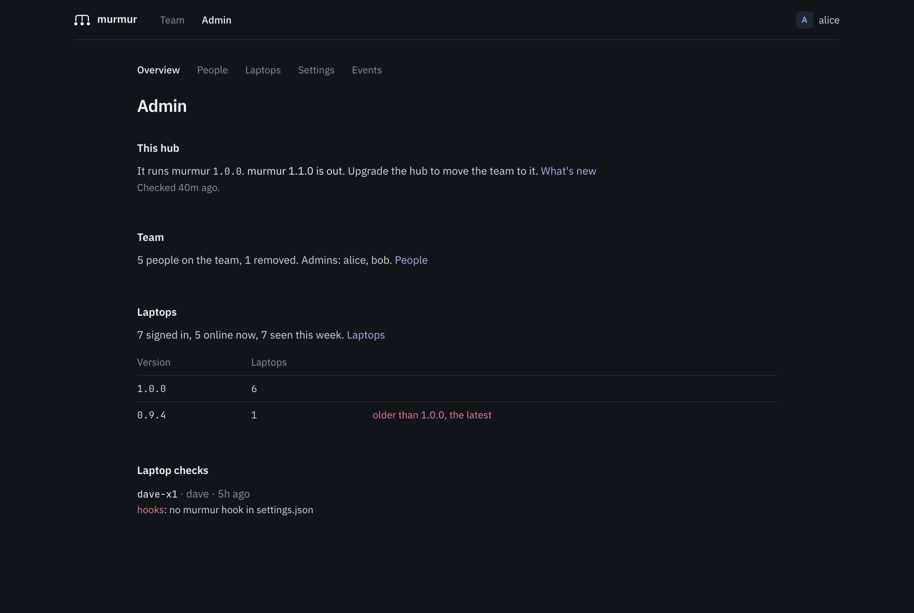

# Hosting a hub

Each team runs one murmur hub. Every laptop on the team keeps a WebSocket open to it, and the hub passes
presence and messages between them. There is no central service: you deploy the hub where you like, and laptops
talk only to it.

This page helps you choose where to run it, which store and bus to use and how to set up sign-in. The folders in
[deploy/](../deploy) hold step-by-step recipes. [configuration.md](configuration.md) lists every setting.

## What a hub needs

- **An HTTPS address** that every laptop and browser on the team can reach, such as
  `https://murmur.example.com`. This is `PUBLIC_URL`.
- **Long-lived WebSockets.** Each laptop holds one connection open for as long as it runs. The platform and any
  proxy in front must allow WebSocket upgrades on `/ws` and leave connections open for many minutes.
- **An identity provider** your team already signs in with.
- **A place for its data**, the store. For one instance a sqlite file on a disk that survives restarts is enough.
- **Nothing that signs people in before the hub.** Laptops, scripts and GitHub reach it without a browser, and the
  hub signs people in itself. Leave the platform's own sign-in off: see
  [managed-services.md](managed-services.md#three-rules).

The hub is one Go binary in a small image.

## Try it in a minute

```sh
docker run --rm -p 127.0.0.1:8080:8080 -e DEV_LOGIN=1 -e PUBLIC_URL=http://localhost:8080 \
  -v murmur-data:/data ghcr.io/eledoneai/murmur-hub
```

Open http://localhost:8080 and sign in by typing any email. The hub refuses to start with `DEV_LOGIN` unless
`PUBLIC_URL` is `http://localhost` or a loopback address, so this is for looking around, not for a team.

## Choose a platform

| Platform | Recipe | Good to know |
|---|---|---|
| One server, Docker Compose | [deploy/compose](../deploy/compose) | The simplest real setup. Caddy gets the certificate. Also a two-instance variant with Postgres. |
| One server, binary and systemd | [deploy/systemd](../deploy/systemd) | No Docker. Bring your own reverse proxy for HTTPS. |
| Kubernetes | [deploy/helm/murmur-hub](../deploy/helm/murmur-hub) | Set your ingress controller's timeouts for WebSockets. |
| Google Cloud Run | [deploy/cloudrun](../deploy/cloudrun) | Connections last at most an hour, then laptops reconnect. No local disk: use Firestore or Cloud SQL. |
| Fly.io | [deploy/fly](../deploy/fly) | One Machine with a volume for sqlite. |
| AWS: ECS Express Mode, or ECS on Fargate with your own load balancer | [deploy/aws](../deploy/aws) | No local disk: use RDS for PostgreSQL. |
| Azure Container Apps, or App Service for Containers | [deploy/azure](../deploy/azure) | No disk safe for sqlite: use Azure Database for PostgreSQL. |

### Not supported

These platforms run code per request and can't hold the long-lived WebSocket each laptop keeps open:

- **AWS Lambda**: a function runs for at most 15 minutes and serves one request at a time; API Gateway's
  WebSocket APIs call a function per message instead of keeping a server connected.
- **Cloudflare Workers**: a Worker runs per request in Cloudflare's JavaScript and WebAssembly runtime. Holding
  WebSockets there takes Durable Objects, a different model from a Go server listening on a port.
- **Vercel**: functions end after a time limit and don't accept WebSocket connections.

**AWS App Runner** has been closed to new customers since 30 April 2026
([AWS](https://docs.aws.amazon.com/apprunner/latest/dg/apprunner-availability-change.html)), and it never supported
WebSockets. ECS Express Mode is AWS's replacement for it: see [deploy/aws](../deploy/aws).

## Choose a store and a bus

The **store** keeps what must survive a restart: people, laptops and their sign-in tokens, messages waiting for
someone offline, settings. The **bus** passes events between hub instances. With one instance, the bus stays in
memory (`local://`).

| Your situation | `STORE` | `BUS` |
|---|---|---|
| Looking around | `memory://` | `local://` |
| One instance on a server or a VM with a disk (most teams) | `sqlite:///data/murmur.db` (the image's default) | `local://` (the default) |
| One instance on a platform without a lasting disk, such as Cloud Run | `postgres://...` or `firestore://PROJECT[/DATABASE]` | `local://` |
| More than one instance | `postgres://...` or `firestore://PROJECT[/DATABASE]` | `postgres://...`, `redis://...` or `rediss://...` |

- **memory** loses everything when the hub stops: everyone signs in again.
- **sqlite** is one file. It needs a disk that outlives the container, and only one instance may use it. Don't
  put it on a network file system such as NFS, EFS or Azure Files.
- **Postgres** can be both the store and the bus, so a two-instance hub needs nothing else. Any recent version
  works, managed or not. The bus needs a direct connection or a session pooler, not a transaction pooler.
- **Redis** works as the bus only. It keeps nothing, so it needs no persistence or backups.
- **Firestore** is Google Cloud's document database, natural on Cloud Run. The hub finds its credentials the way
  Google's client libraries do: the service account on Google Cloud, or `GOOGLE_APPLICATION_CREDENTIALS`
  elsewhere.

[managed-services.md](managed-services.md) goes through the clouds' managed Postgres and Redis services: which
endpoint to use, and which poolers and flavours don't work.

One instance is enough for a team: if it restarts, laptops reconnect within seconds and resend what was waiting.
Run two when even that short gap matters, or to upgrade without one.

## Set up sign-in

Pick one provider. In every case, register this redirect URL with it:

```
PUBLIC_URL/auth/callback        for example https://murmur.example.com/auth/callback
```

Then say who may join with `ALLOWED_DOMAINS`, `ALLOWED_EMAILS` or `ALLOWED_GITHUB_ORGS`, and name the first
admins in `ADMINS`. With none of the three lists, only admins can sign in. If you set more than one provider, the
hub uses the first of OIDC, Google and GitHub.

### Google

1. In the Google Cloud console, open **Google Auth Platform**, and set up the consent screen. For a Google
   Workspace organization, choose the **Internal** audience: only your organization's accounts can sign in.
2. Under **Clients**, create an **OAuth client** of type **Web application**, with the redirect URL above under
   **Authorized redirect URIs**.
3. Set `GOOGLE_CLIENT_ID` and `GOOGLE_CLIENT_SECRET`, and `ALLOWED_DOMAINS` to your Workspace domain. With one
   domain there, Google's sign-in page offers only accounts of that domain.

### Microsoft Entra ID

1. In the Entra admin center, open **App registrations** and choose **New registration**. Pick **Accounts in this
   organizational directory only**, and add the redirect URL above with the **Web** platform.
2. Under **Certificates & secrets**, create a client secret.
3. Set:
   ```sh
   OIDC_ISSUER=https://login.microsoftonline.com/<directory (tenant) ID>/v2.0
   OIDC_CLIENT_ID=<application (client) ID>
   OIDC_CLIENT_SECRET=<the secret's value>
   OIDC_NAME=Microsoft
   OIDC_TRUST_EMAIL=1
   ```
   Entra doesn't mark email addresses as verified in its tokens. Within your own tenant, your admins set the
   addresses, so `OIDC_TRUST_EMAIL=1` is safe with the tenant-specific issuer above. Never use it with the
   `common` or `organizations` issuers. If sign-in fails because the email is missing, add the optional claim
   `email` to the ID token under **Token configuration**.

### Okta

1. In the Okta admin console, go to **Applications**, **Create App Integration**, choose **OIDC - OpenID
   Connect** and **Web Application**.
2. Add the redirect URL above under **Sign-in redirect URIs**, and assign the people or groups who may use it.
3. Set `OIDC_ISSUER=https://<your Okta domain>` (or `https://<your Okta domain>/oauth2/default` if you use the
   default custom authorization server), `OIDC_CLIENT_ID`, `OIDC_CLIENT_SECRET` and `OIDC_NAME=Okta`.

### Keycloak

1. In your realm, go to **Clients**, **Create client**, type **OpenID Connect**, client ID `murmur`.
2. Turn on **Client authentication**, keep **Standard flow**, and add the redirect URL above under **Valid
   redirect URIs**.
3. Copy the secret from the **Credentials** tab.
4. Set `OIDC_ISSUER=https://<keycloak host>/realms/<realm>`, `OIDC_CLIENT_ID=murmur`, `OIDC_CLIENT_SECRET`
   and `OIDC_NAME`.

Keycloak sends each user's **Email verified** flag. If your users don't have it, and your Keycloak is the source
of truth for their addresses, set `OIDC_TRUST_EMAIL=1`.

### Authentik

1. Go to **Applications**, **Create with provider**, and pick **OAuth2/OpenID Provider**.
2. Make the client **Confidential**, add the redirect URL above (strict match), and choose a signing key.
3. Set `OIDC_ISSUER=https://<authentik host>/application/o/<application slug>/` (with the final slash),
   `OIDC_CLIENT_ID`, `OIDC_CLIENT_SECRET` and `OIDC_NAME`.

If authentik reports your users' addresses as not verified and it is the source of truth for them, set
`OIDC_TRUST_EMAIL=1`.

### GitLab

1. In GitLab (gitlab.com or your own), open **Applications** in your group's, the instance's or your user's
   settings and add one.
2. Enter the redirect URL above, keep **Confidential** checked, and select the scopes `openid`, `profile` and
   `email`.
3. Set `OIDC_ISSUER=https://gitlab.com` (or your GitLab's address), `OIDC_CLIENT_ID` to the application ID,
   `OIDC_CLIENT_SECRET` to its secret, and `OIDC_NAME=GitLab`.

### GitHub

GitHub sign-in isn't OpenID Connect, so it has its own settings.

1. Create an OAuth app: in your organization's settings (or your own), **Developer settings**, **OAuth Apps**,
   **New OAuth App**. Use `PUBLIC_URL` as the homepage URL and the redirect URL above as the **Authorization
   callback URL**.
2. Generate a client secret.
3. Set `GITHUB_CLIENT_ID`, `GITHUB_CLIENT_SECRET` and `ALLOWED_GITHUB_ORGS=<your organization>`. For GitHub
   Enterprise Server, also set `GITHUB_URL=https://<your GitHub host>`.

If your organization restricts OAuth app access, an owner must approve this app, or the hub can't see who
belongs to the organization.

## Reverse proxies and WebSockets

Laptops connect to `wss://<your hub>/ws`. Whatever sits in front of the hub must pass the WebSocket upgrade
through and keep the connection open. Laptops and the hub ping each other every 25 seconds, so an idle timeout
of a minute is enough; an hour leaves a wide margin. When a proxy does cut a connection, the laptop reconnects
and resends what was not confirmed, so a cut costs a reconnection, not messages.

- **Caddy** passes WebSockets through with no time limit. `reverse_proxy localhost:8080` is all it needs.
- **nginx** needs the upgrade headers. Its 60-second timeouts are enough with the pings; this example raises them
  to leave a margin:

  ```nginx
  map $http_upgrade $connection_upgrade {
      default upgrade;
      ''      close;
  }

  server {
      listen 443 ssl;
      server_name murmur.example.com;
      # ssl_certificate and ssl_certificate_key here

      location / {
          proxy_pass http://127.0.0.1:8080;
          proxy_http_version 1.1;
          proxy_set_header Upgrade $http_upgrade;
          proxy_set_header Connection $connection_upgrade;
          proxy_set_header Host $host;
          proxy_set_header X-Forwarded-For $proxy_add_x_forwarded_for;
          proxy_set_header X-Forwarded-Proto $scheme;
          proxy_read_timeout 3600s;
          proxy_send_timeout 3600s;
      }
  }
  ```

- **ingress-nginx** on Kubernetes was archived on 24 March 2026
  ([Kubernetes](https://kubernetes.io/blog/2025/11/11/ingress-Nginx-retirement/)) and gets no more fixes. Where it
  still runs, the Helm chart's annotations set its `proxy-read-timeout` and `proxy-send-timeout` to 3600.
- **AWS Application Load Balancer**: its default idle timeout of 60 seconds works, because WebSocket pings count as
  traffic. Raising it, to 3600 for example, is harmless but not needed
  ([AWS](https://docs.aws.amazon.com/elasticloadbalancing/latest/application/edit-load-balancer-attributes.html)).
- **Google Cloud Run** ends every request at its timeout, 60 minutes at most: deploy with `--timeout=3600`.
- **Azure Container Apps and App Service** document a timeout of about four minutes. The pings keep a connection
  from sitting idle that long; if one is still cut, the laptop reconnects ([deploy/azure](../deploy/azure)).
- **Other proxies and load balancers**: allow WebSocket upgrades and set the idle timeout to an hour or more.

Hub instances don't need sticky sessions: each laptop's connection stays on the instance it reached, and the bus
carries what the others need.

## The admin panel

Admins find it in the header of the hub's pages, at `/admin`. Its pages draw from `/api/admin`, which answers
admins only, and every action that signs someone out or takes rights away asks first.

<picture>
  <source media="(prefers-color-scheme: light)" srcset="assets/admin-light.png">
  
</picture>

- **Overview**: the hub's version and, with the release check on, whether a newer release is out; how many people,
  admins and laptops; the versions laptops run, with those older than the hub or than the oldest accepted
  version; and the laptops whose last self-check failed.
- **People**: everyone, with their role and laptops. Make someone an admin, or take the rights away, never from
  the last admin. Remove someone: every laptop of theirs is revoked at once, the messages kept for them are
  deleted, and they can't sign in again; their account with your identity provider is untouched. Let them back in
  later; their old laptops stay revoked. Nobody can remove themselves. Who may join is on this page too.
- **Laptops**: every laptop with its person, version, connection and last self-check. Revoking one disconnects it
  at once.
- **Settings**: everything in [configuration.md](configuration.md#admin-settings).
- **Events**: sign-ins, laptops signed in and revoked, people removed and let back in, admin rights given and taken,
  settings changed and announcements sent, never the text of a message. The log keeps the newest 10,000 events,
  none older than 90 days.

To take admin rights from someone listed in `ADMINS`, take them out of `ADMINS` too: otherwise they become an admin
again at their next sign-in.

## The team's chat

With a chat webhook set in **Admin › Settings**, the hub posts to your team's chat (Slack, Google Chat, Discord,
Microsoft Teams, or anything that takes `{"text": …}`):

- an agent that has waited 15 minutes for its person (the default), once per wait: the person's handle, the
  agent's name, repo and branch, how long, and the hub's address;
- on Monday at the start of the working day, the week before in team totals: how long agents waited, the five
  files changed in two checkouts at once most often, how many messages went between different people's agents,
  and how many merge notices went out. A quiet week posts nothing.

It posts only in working hours, 9 to 19 on weekdays by default, in the time zone of the settings, which is UTC
until an admin changes it: set it to your team's. A wait that started at night is posted when the working day
starts, if it still holds. A post the chat refuses is not tried again.

## GitHub merge notices

When a pull request merges on GitHub, the hub tells each online agent whose branch in that repo changes the same
files, so it rebases before it pushes. To set it up:

1. In **Admin › Settings**, under GitHub merge notices, enter a webhook secret (a long random string, such as
   the output of `openssl rand -hex 32`) and a read-only token: a fine-grained personal access token with
   **Pull requests: Read-only** on your repositories. The hub reads each merged pull request's files with it.
2. In GitHub, in the repository's or the organization's settings, add a webhook: payload URL `PUBLIC_URL`
   followed by `/github/webhook`, content type `application/json`, the same secret, and only the **Pull requests**
   event.
3. If a proxy sits in front of the hub, let it pass `/github/webhook` through.

GitHub Enterprise Server works the same way when `GITHUB_URL` names it: the hub sends its token only to
api.github.com and to that server.

## Backups

Back up the store. The bus holds nothing worth keeping.

- **sqlite**: copy the file while the hub runs with `sqlite3 murmur.db ".backup copy.db"`. Each recipe shows
  where the file is.
- **Postgres**: `pg_dump`, or your provider's automated backups.
- **Firestore**: scheduled backups or point-in-time recovery, which Google Cloud offers for each database.

Without a backup, losing the store means everyone signs in again, laptops are connected again, and messages
waiting for people who were offline are gone. Live presence rebuilds itself as laptops reconnect.

## Upgrading

Deploy a newer image. Each image carries the laptop binaries of its own version, so a hub serves updates without
reaching the internet. When laptops reconnect, the hub tells them its version, and the update policy in
**Admin › Settings** says what they do:

- **auto**, the default: each laptop updates itself once none of its agents is busy;
- **notify**: the console says a version is ready, and each person runs `murmur update`;
- **off**: laptops stay on their version until their people run `murmur update`.

Each person can also set their own laptop with `murmur updates ask` or `off`. To make everyone move, set the
oldest accepted version: the hub refuses older laptops, and they update themselves whatever the policy, unless
their person chose `off`.

A laptop checks the release signature and each download's checksum, keeps its previous binary, and goes back to it
if the new version doesn't reach the hub within a minute. Installs from Homebrew or Nix never replace themselves:
their people run `brew upgrade murmur` or update their Nix configuration.

Laptops never move to an older version because a hub says so, so rolling a hub back doesn't roll laptops back.

## A short checklist

- `PUBLIC_URL` is `https://`, and `DEV_LOGIN` is unset.
- `SESSION_SECRET` is long and random, and kept out of version control.
- The store and the bus are not reachable from the internet, and they need a password.
- `ALLOWED_DOMAINS`, `ALLOWED_EMAILS` or `ALLOWED_GITHUB_ORGS` is set, and `ADMINS` names at least one person.
- An admin has set the team's time zone in **Admin › Settings**, if you use the team's chat.
- The image tag is pinned to a release, and you know where its release notes are.
