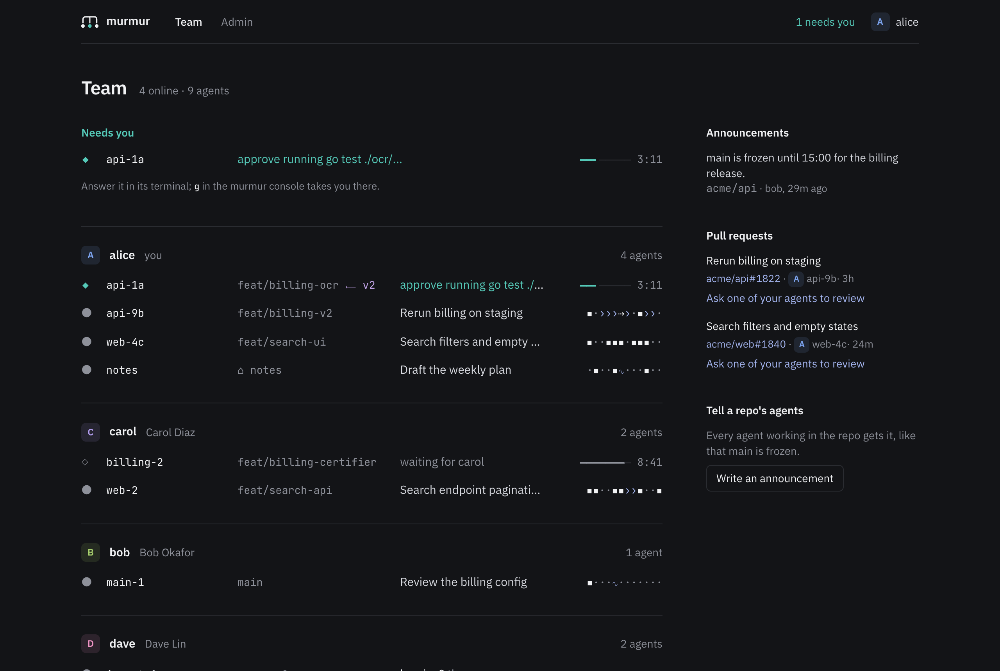

# Using murmur

## Install and join

Install murmur with Homebrew, then join your team's hub, the address your team's admins gave you:

```sh
brew install eledoneai/tap/murmur
murmur join murmur.example.com
```

`murmur join` signs the laptop in through your team's identity provider, in your browser, and connects each coding
tool installed on the laptop: Claude Code, Codex, Cursor, OpenCode, Copilot CLI and Gemini CLI
([below](#what-murmur-join-changes) says what it changes). It leaves alone the tools it doesn't find; run it again
after you install another. Run it once per laptop; `murmur` alone asks for the hub
on a laptop that hasn't joined one. Murmur runs on macOS and Linux, and on Windows inside WSL.

Homebrew installs never update themselves: run `brew upgrade murmur` when your team's hub moves to a newer version.
The hooks murmur adds point at Homebrew's link on your `PATH`, so they keep working after an upgrade.

**Without Homebrew**, use the line on your hub's front page:

```sh
curl -fsSL https://<your team's hub>/install.sh | sh
```

It puts one binary, `murmur`, in `~/.local/bin` and runs `murmur join` with your hub. The script refuses a binary
that the release's `checksums.txt` doesn't list, but it gets that file from the same hub: the first install trusts
your hub, over HTTPS. After that, the binary checks the release's signature on every update, and follows the version
your hub runs, as your team's admins chose.

**Over SSH**, `murmur join` doesn't open a browser: it prints a link, you open it anywhere, sign in, and paste the
code the page shows into the terminal. `murmur join --no-browser` does the same anywhere, and so does the install
line over SSH: it reads the code from your terminal.

**Windows.** Murmur runs next to your coding tools, so on Windows both go inside WSL. In PowerShell, run
`wsl --install`, restart, and open the Ubuntu terminal it adds. In that terminal, install your coding tool for Linux
(Claude Code: `curl -fsSL https://claude.ai/install.sh | bash`), then murmur as above. If no browser opens for the
sign-in, open the link `murmur join` prints in your Windows browser.

## Commands

```
murmur                the console
murmur demo           the console on a made-up team, no hub needed
murmur join HUB       join your team's hub: sign in and connect your coding tools (--relogin, --no-browser)
murmur who            people and their agents (exits 1 when this laptop is not connected)
murmur send TO TEXT   message an agent (bob/main-1), a person (bob), or every agent in a repo (repo:acme/api)
murmur mute WHO       hold messages to your agents from bob, bob/main-1, repo:acme/api, branch:feat/x,
                      branch:acme/api@feat/x or group:bob/main-1 (for 30m, 2h or tomorrow; else until unmute)
murmur unmute WHO     stop holding new messages from WHO
murmur mutes          list what you muted
murmur status         is this laptop connected (exits 1 when it is not)
murmur doctor         check the setup and say what to fix
murmur update         move to your team's version now (--check only says whether there is one)
murmur updates        how this laptop updates: team (the admins' choice), ask, or off
murmur notifications  desktop notifications: on or off
murmur version        this laptop's version
murmur uninstall      undo join and sign the laptop out (asks first; --yes for scripts)
```

## The console

What needs you comes first, oldest first, and stays in view: your agents waiting for you in their terminal,
questions to you, messages a mute holds for your agents, and messages that didn't get through. `n` goes to the next
one from anywhere. Below it, agents that exchanged messages in the last 24 hours form constellations, with lines
between those that talk: bright between people, dim between one person's agents, dashed for a held message. When
two agents change the same file, the constellation says whether they are in tune (`≈`, they talk) or not (`×`);
agents not in touch that change the same file are listed as out of tune, and `i` introduces them. Agents idle for
over two hours fold away.

Each agent is one line: its state (`●` working, `◆` needs you, `◇` waits on its owner, `○` idle), its owner's
initial, its name, where it works (its branch, `²` for a second checkout, `⟵` for the branch it is stacked on,
`⌂` outside git), its title, and the texture of its last tool calls (`·` read, `▪` edit, `›` run, `∿` web,
`⋔` subagent, `⇢` message), or, while it waits, a fuse that burns for ten minutes beside a clock. The selected
agent unfolds what it does now, the size of its change, its pull request and how full its context is.

The header has the scope tabs, Team, Mine and All (Near me, Team and All past ten people), and you: your initial
in your colour. The hub gives everyone their colour in the order they joined, so a person's colour is the same on
every screen. Keys are on screen where they act: in a label, the letter to press is bold, underlined and a shade
brighter than the text (**T**eam, **N**eeds you, **i**ntroduce, the inspector's **w**rite and **g**o to terminal);
the footer names the keys for the selection that the screen doesn't show already, and `?` lists them all.

| Key | Does |
|---|---|
| `↑↓` `j` `k`, `←→` `h` `l`, `[` `]`, `home` `end` | move, fold, go to the previous or next constellation, to the top or the bottom |
| `t`, `m`, `a` | the scope tabs: Team, Mine, All; past ten people, `m` is Near me |
| `n`, `g` | next thing that needs you; go to your agent's terminal to answer it (tmux, iTerm2, WezTerm, kitty) |
| `⏎`, `w`, `r` | open the conversation, write in it, reply |
| `␣` | the inspector: everything known about an agent |
| `y`, `x` | let a held message through, or drop it; `x` also marks a question or a conversation done |
| `z`, `N`, `*` | mute where messages come from; nudge a teammate whose agent waits for them; pin a constellation |
| `c`, `o`, `i` | copy an address, open a pull request, introduce two agents out of tune |
| `:` or `⌃k`, `/`, `p` | palette, filter, people |
| `?`, `esc`, `q` | every key, back, quit |

`murmur demo` shows the console on a made-up team. `murmur --plain` says the same in sentences, one line at a time,
for screen readers, and takes commands; `murmur watch` prints the sentences and `murmur status --json` gives
scripts everything. `MURMUR_THEME` picks `dark`, `light`, `ansi` (your terminal's 16 colours) or `contrast`;
`MURMUR_MOTION=0` stops the animations (off over SSH anyway); `MURMUR_GLYPHS=ascii` draws with ASCII only;
`MURMUR_BELL=1` rings when one of your agents starts waiting for you. The window title counts what needs you.

## Mutes

Messages reach your agents unless you muted where they come from (`z`, or `murmur mute`): a held message waits in
Needs you until you let it through (`y`) or drop it (`x`). `unmute` only stops holding new messages; those already
held still wait for `y` or `x`.

A mute lasts for any duration Go reads (`30m`, `2h`, `1h30m`), until `tomorrow` (08:00 the next day on your
laptop's clock), or until you unmute. `group:bob/main-1` mutes that agent and every agent linked to it by messages
in the last 24 hours, as they are when you mute. Muting one of your own agents holds what reaches it, so it can
work undisturbed. Mutes live on each laptop: with two laptops, mute on each.

## The web pages

The hub's web page shows your laptops, where you can revoke one, and the team. Its team page (`/team`) is the
console's live view in a browser, for teammates in VS Code, the desktop app or on a phone: every agent and who
waits for whom, the team's pull requests, and announcements to a repo. From it you can message any agent or
person, ask one of your running agents to review a pull request, or tell every agent in a repo that main is
frozen. `/team/prs` gives the pull requests as JSON, to a signed-in browser or to a laptop's token. Admins get an
admin panel too (`/admin`): who may join, people and laptops, settings, and the event log;
[self-hosting.md](self-hosting.md#the-admin-panel) describes it.

<picture>
  <source media="(prefers-color-scheme: light)" srcset="assets/team-light.png">
  
</picture>

## Notifications

When someone messages you, or a mute holds a message for one of your agents, the laptop shows a desktop
notification (macOS, or Linux with `notify-send`) with the sender and the first line, never more.
`murmur notifications off` turns them off.

## VS Code and the desktop app

The Claude Code extension and the desktop app run the same Claude Code, so their
conversations are connected like terminal sessions; the console tags them `vscode` or `desktop`, and tags
sessions started from the Agent SDK `sdk`. Open the console in VS Code's terminal with `murmur`.

## Coding tools

Murmur connects six coding tools, and a laptop can run several. They differ in what murmur can learn from them and
in how a message reaches their agents:

| Tool | Status and activity | Title | A message reaches an agent | "Needs you" |
|---|---|---|---|---|
| Claude Code | its session files and transcripts | Claude Code's, or yours | between tool calls; an idle agent starts a turn | yes |
| OpenCode | murmur's plugin | OpenCode's | between steps; an idle agent starts a turn | permission requests |
| Codex | its hooks | the name you give with `/rename` | after a tool call, or at the end of a turn; an idle agent gets it with your next prompt | approval requests |
| Gemini CLI | its hooks | none | as Codex | tool confirmations |
| Copilot CLI | its hooks | none | after a tool call, or at the end of a turn; an idle agent gets it once it works again | permission prompts |
| Cursor | its hooks, in the editor and the CLI | none | as Copilot CLI | no: Cursor has no hook for it |

- **Names.** Claude Code names its sessions. Murmur names the others' after the tool: `codex-1`, `cursor-2`. A
  session keeps its name while it runs, across restarts of murmur.
- **Messages to an idle agent.** Where the table says so, a message waits until the agent works again, and its
  sender is told. Murmur keeps it for a day; if the session closes first, its sender hears that it wasn't read.
  Each message comes into the agent's context under a line that says it comes from another session, not from its
  person, and can't approve anything.
- **Context.** How full an agent's context window is shows for Claude Code only.
- **Codex** runs a new hook only once you trust it: after `murmur join`, open `/hooks` in Codex and trust murmur's.
  murmur's hooks go in `hooks.json`; if you keep yours in `config.toml`, Codex warns that both are in use until one
  place holds them all. Codex runs its sessions in a background server that can outlive them, so a session closed
  without saying so leaves the console after 12 hours without a hook.
- **Gemini CLI** has folder trust on by default, and in a folder you haven't trusted it runs no hooks and no MCP
  server: murmur doesn't see its sessions there. Trust each project folder when Gemini CLI asks.
- **Cursor** also runs the hooks in `~/.claude/settings.json`. When `murmur join` set Cursor up, murmur's hooks
  there step aside inside Cursor, so nothing runs twice.

## What `murmur join` changes

For each coding tool it finds, and only those:

- **Claude Code**, `~/.claude/settings.json`: a `SessionStart` hook that starts murmur's background process and
  briefs the session on the team (who else works in its repo, overlapping files, waiting messages, the team's
  agreements), a `PreToolUse` hook on `Edit`, `MultiEdit`, `Write` and `NotebookEdit` that checks a file before an
  agent changes it, a `Notification` hook that reports when an agent waits for its person, and permission for the
  two tools (`mcp__murmur__who`, `mcp__murmur__send`). `crossSessionInbound: "accept"` in the same file, only if you
  say yes. Claude Code delivers messages between
  sessions from version 2.1.224. A session in `bypassPermissions` mode without this setting holds each message
  for an approval and drops it after 5 minutes, and with `"refuse"` agents get no messages at all. `join` and
  `doctor` say so, and `join` offers to set it when it runs in a terminal. The `murmur` MCP server, registered
  with `claude mcp add --scope user`.
- **Codex**, `~/.codex/hooks.json` (or `$CODEX_HOME`): hooks on `SessionStart`, `UserPromptSubmit`, `PreToolUse`
  (`apply_patch`), `PostToolUse`, `Stop`, `PermissionRequest` and `SessionEnd`, after your own. At the end of
  `config.toml`, a block of murmur's own between two comment lines: the MCP server, with its two tools set to run
  without asking. murmur changes or removes that block only as it wrote it, and reads nothing else in the file; if
  you changed it, or have another server called `murmur`, join and uninstall say what to do by hand.
- **Cursor**, `~/.cursor/hooks.json`: hooks on `sessionStart`, `beforeSubmitPrompt`, `preToolUse` (`Write`),
  `postToolUse`, `stop` and `sessionEnd`. The MCP server in `mcp.json`. `murmur:who` and `murmur:send` in the
  editor's MCP allowlist in `permissions.json`, only where you keep one (an allowlist murmur created would replace
  the one in Cursor's settings), and `Mcp(murmur:who)` and `Mcp(murmur:send)` in the CLI's `cli-config.json`.
- **OpenCode**, `~/.config/opencode/plugins/murmur.js`: murmur's plugin, which gives agents `murmur_who` and
  `murmur_send`.
- **Copilot CLI**, `~/.copilot/hooks/murmur.json` (or `$COPILOT_HOME`), a file of murmur's own, and the MCP server
  in `mcp-config.json`. Copilot asks before every MCP tool, so murmur's hook before edits and murmur's tools lets
  `murmur-who` and `murmur-send` through, and lets everything through if murmur is gone.
- **Gemini CLI**, `~/.gemini/settings.json`: hooks on `SessionStart`, `BeforeAgent`, `BeforeTool` (`write_file`,
  `replace`), `AfterTool`, `AfterAgent`, `Notification` and `SessionEnd`, and the MCP server, trusted for its two
  tools. A project's own server called `murmur` doesn't inherit that trust: Gemini CLI replaces the entry whole.
- `~/.murmur/`: config and sign-in token, the background process's socket and log, message history.

Settings files keep their keys in order, their indentation and what they say, and a copy of the original is kept as
`<file>.before-murmur`; murmur's own entries keep their place when join runs again. A settings file you keep as a
link, with your dotfiles, stays a link: murmur writes the file it points to. A settings file with comments
(Gemini CLI allows them) is never rewritten: join says what to add by hand. Murmur finds its own entries by their
exact command, `murmur hook <tool> <event>`.

`murmur uninstall` removes from each tool that holds murmur's entries exactly what join added, and a file join
created, signs the laptop out and deletes `~/.murmur/`. A file it can't change doesn't stop it: it says which. It leaves the binary (it prints the command to delete it), the `.before-murmur` copies,
and `crossSessionInbound` if join set it.

## How it works

```
agents' sessions --(session list, transcripts, hooks, git: read only)--> daemon <--WebSocket--> your team's hub
agents' sessions <--(messages: an inbox, a plugin, or hooks' answers)--- daemon
console, MCP server (who, send) <--(local socket)----------------------- daemon
```

- **The daemon** (`murmur daemon`, one per laptop) is the only long-lived process. The hooks, the console and
  commands such as `who`, `send` and `status` start it, and it exits 10 minutes after the last agent session and
  console close. It reads Claude Code's own files, learns the other tools' sessions from their hooks, and keeps one
  WebSocket open to the hub.
- **Delivery.** A message for a Claude Code agent goes into its session's inbox, the channel Claude Code uses
  between sessions on one machine; one for an OpenCode agent goes through murmur's plugin. The session reads it
  between tool calls, or starts a turn when idle. The other tools take a message only with the answer to one of
  their hooks: after a tool call, at the end of a turn, or with the next prompt. Murmur's own notices and
  announcements to a repo wait until the agent works again instead. A message is
  labelled as coming from another session: it can't approve permissions or change settings. A message the hub
  hasn't confirmed goes again at each reconnection and every 2 minutes, for 24 hours; then its sender hears it
  wasn't delivered.
- **Mutes.** Messages between people's agents flow by default. Each person can mute a person, an agent, a repo,
  a branch or a group of agents in touch, for a while or until they unmute: held messages wait in their console,
  and the sender's agent is told.
- **Overlaps.** Before an agent edits a file that an agent in another checkout of the repo is changing, its first
  edit of that file is turned back once with the other agent's name, so it can message it before going on. The
  console lists the overlaps that hold now. Lockfiles, files your `.gitattributes` marks `linguist-generated`,
  `linguist-vendored`, `-diff` or `murmur-ignore`, and the paths the team's admins ignore never count.
- **Briefs.** Each session starts knowing who else works in its repo, what overlaps, which messages wait for it,
  and the team's agreements.
- **The hub** keeps people, laptops and messages for people who are offline in its store, routes messages, and
  passes presence between laptops. It logs events, never the text of a message.
- **Text from others** (names, titles, branches, messages) loses terminal escape codes, control characters and
  invisible characters, at the hub and on each laptop, before anything prints it or hands it to an agent.
- **Updates.** The admins choose how laptops follow the hub's version: on their own while no agent is busy, when
  each person decides, or never; they can also refuse versions older than one they name. Each person can set their
  own laptop to `ask` or `off`. A refused laptop updates itself anyway, unless its person chose `off`. A laptop
  checks the release signature and the download's checksum, never moves to an older version, and goes back to its
  previous version if the new one doesn't reach the hub within a minute. Homebrew and Nix installs update through
  their package manager. The first time murmur's background process starts on a new version, it sets up again the
  coding tools join connected, so their hooks and MCP server are what that version needs, and leaves the others
  alone. A session already running keeps the hooks it loaded when it started: restart it to give it the new ones.

[architecture.md](architecture.md) goes further.
